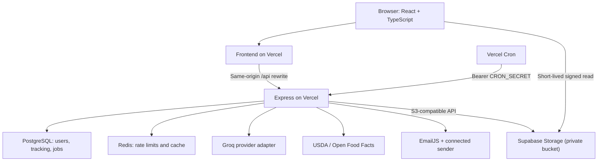
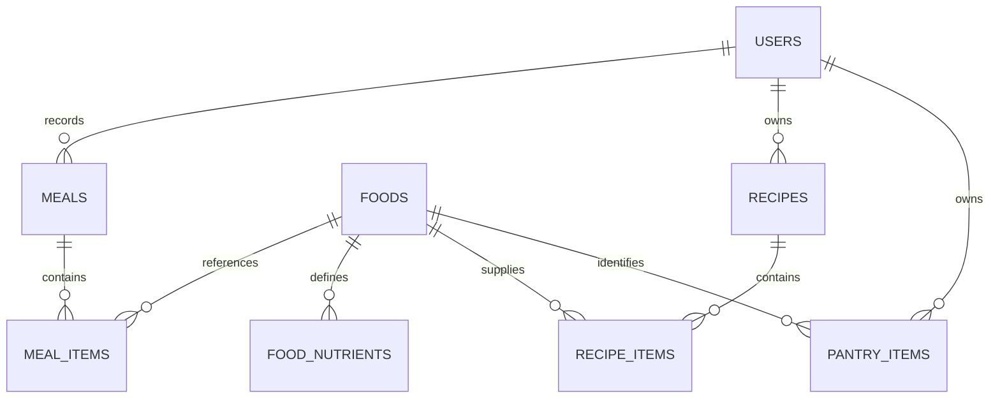
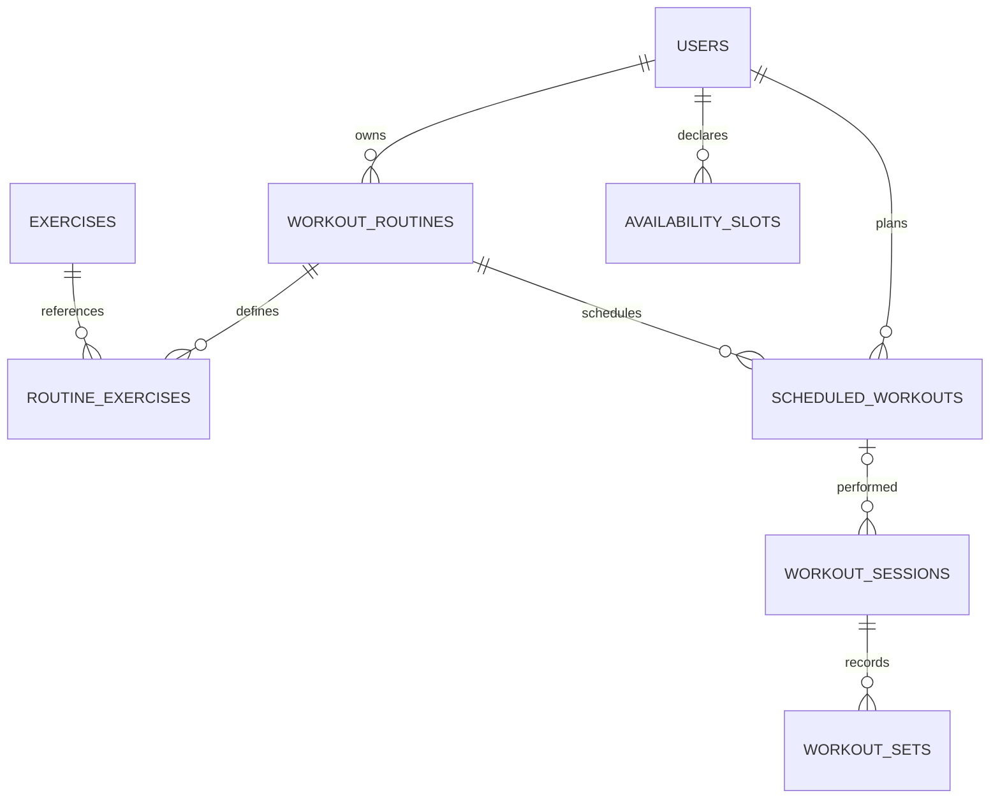
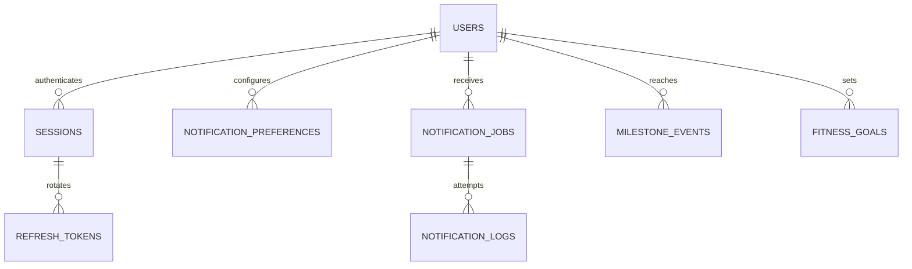

# Fit Tempo — Fitness and Nutrition Web Application Architecture

Prepared: November 16, 2026 (Asia/Manila)

Project name: **Fit Tempo**. Use this exact display name in UI copy, email templates, documentation, and portfolio materials. Use `fit-tempo` for technical slugs, package/project names, and example repository names. Suggested tagline: “Your meals. Your movement. Your rhythm.” Name, domain, and trademark availability have not been checked. This project is inspired by food/fitness trackers, not a Bitalyze clone or affiliation. This document replaces neither the manga nor anime plans. It is a new web project specification; no application code, provisioning, or email sending has been performed.

## 1. Project overview and scope

Build **Fit Tempo**, a responsive **pure web application**, not React Native or a native mobile app. Trainees record meals, nutrients, routines, workouts, activity, water, weight, measurements, and goals. Two differentiators are included: **Pantry and Budget Meal Planner** and **Fit My Week**. Require sign-in for private app features. Admins curate shared food/exercise catalogs and manage account status; authorization is enforced by Express.

Use a modular monolith: one React application, one Express API, one PostgreSQL database. Prioritize a small portfolio-ready vertical slice before optional enhancements. No microservices, model training, background wearable integration, medical treatment recommendations, or implied continuous browser activity monitoring.

| Role | Allowed | Boundaries |
| --- | --- | --- |
| trainee | Own logs, routines, schedules, recipes, pantry, goals, preferences, and notification history | Cannot read another user's records or change role/verified status |
| admin | Account status, shared foods/exercises/categories, application-level aggregate operations and audits | No default access to private food photos, weight records, or personal health histories; explicit need-based access only if later specified |

MVP: account verification/recovery, dashboard, manual food/water/body/activity logs, curated foods/exercises, workout scheduling/logging, goals, rule-based pantry suggestions, Fit My Week confirmation flow, notification preferences, and portfolio demo fixtures. Then add USDA/barcode integrations, editable AI photo suggestions, bounded scheduled emails, admin tools, and richer analytics. Progress photos, camera barcode scanning, maps, and AI prose enrichment can be deferred without breaking core tracking.

## 2. Technology stack and service costs

| Layer | Technology | Responsibility |
| --- | --- | --- |
| Web | React, TypeScript, Vite, React Router | Responsive pages and protected navigation |
| Server state | TanStack Query | Fetching, cache, pagination, mutation invalidation |
| Client state | Zustand | Drawer, draft planner selections, timer UI; not duplicate server records |
| Forms/UI | React Hook Form, Zod, shadcn/ui, Tailwind CSS, Lucide React | Accessible forms and reusable visual components |
| Charts | Recharts | Recorded-data trends, explicitly labeled gaps/coverage |
| API | Node.js, Express, TypeScript, Zod | Auth, permissions, validation, business rules |
| Database | PostgreSQL, pg, ordered SQL migrations | Durable records, sessions, notification queue |
| Request limits | express-rate-limit + rate-limit-redis | Shared IP/account/user counters across Vercel instances |
| Temporary shared state | Managed Redis, compatible driver | Quotas, AI locks, caches; durable jobs remain in PostgreSQL |
| Auth | Argon2id, maintained JWT/JOSE library, HttpOnly cookies | Custom session-backed JWT login/logout |
| AI | Groq provider adapter | Photo food suggestions and optional explanation/ranking |
| Food data | USDA FoodData Central, Open Food Facts | Nutrient lookup and barcode records |
| Email | EmailJS through its server-side send API | Backend-triggered fixed templates through a connected sender |
| Scheduler | Vercel Cron Jobs | Authenticated production endpoint triggers persisted jobs |
| Files | Supabase Storage (private bucket, S3-compatible API) | Authenticated uploads through Express, short-lived signed reads, file metadata in PostgreSQL |
| Tests | Vitest, API integration tooling, Playwright | Business rules, auth, concurrency, browser flows |

Libraries are generally open source; review licenses and pin compatible versions. Service hosting may cost money. Groq offers model-dependent free quotas, not unlimited access. USDA requires an API key and enforces limits. Open Food Facts is open data with endpoint limits, attribution/license obligations, and incomplete product coverage. Redis/database/object storage free tiers have quotas and may suspend. EmailJS and its connected email service have separate send/rate allowances. Vercel frequent cron may require a paid plan or external scheduler. Do not fabricate current plan allowances or prices.

OpenStreetMap is optional for a later user-initiated route view. Its data license does not grant unlimited public tile service usage. Observe tile attribution/policies and do not add maps merely to expand scope.

## 3. Overall system architecture



The browser never connects directly to PostgreSQL or sends privileged Groq/EmailJS calls. Public frontend static files are not a security boundary. Express validates auth, ownership, CSRF, input, and quotas before business operations. File storage grants are server-authorized and limited to owned objects. Cron executes independently of whether the user has a browser open.

## 4. Authentication and authorization

Use access JWTs in HttpOnly cookies plus persistent server sessions. Proposed defaults: 10-minute access token, rotating random opaque refresh secret, 7-day idle session expiry and 30-day absolute expiry. An opaque refresh secret does not need to be a JWT. JWT contains minimal sub/sid/jti/iss/aud/iat/exp, never health data or passwords. PostgreSQL stores password/refresh/reset hashes only.

Registration: validate/normalize email, Argon2id-hash password, create unverified trainee, send verification via EmailJS. Only backend-approved admin provisioning changes roles; no client-selected admin role. Verify email before normal private sessions. Login creates a new session; every protected request verifies JWT signature, algorithm, issuer/audience/expiry plus active user/session and backend role. Use current database role/status rather than user-editable claims for admin authorization.

Refresh: validate hash, expiry, session, and token family; rotate atomically with replay detection. Specify a tested legitimate concurrent-refresh policy and coordinate browser tabs to avoid accidental family revocation. Logout is a CSRF-protected POST that revokes the server session and clears cookies; copied access JWTs must be rejected on subsequent API calls. Logout-all/reset revoke all relevant sessions. No positive session caching if immediate revocation is promised.

Production cookies: __Host-fitness_access and __Host-fitness_refresh, HttpOnly, Secure, SameSite=Lax, Path=/, no Domain, explicit expiry. Local HTTP uses an explicit development-only policy. No tokens in localStorage, sessionStorage, JS-readable cookies, JSON responses, analytics, or URL parameters. JWT signing secret belongs only in Express; use a maintained library, rotation-ready key configuration, and adequate key entropy.

CSRF: reviewed pre-auth and session-bound token mechanism with X-CSRF-Token and canonical Origin checks for unsafe methods, including login, refresh, logout, uploads and account changes. SameSite is defense in depth. Password reset/verification links carry one-use purpose-bound secrets, not login JWTs. GET link opens must not consume tokens because email scanners may follow them. Remove secrets from history promptly and keep recovery pages free of trackers. Generic recovery responses prevent account enumeration. HttpOnly mitigates token theft but does not make XSS safe.

## 5. Application modules and the two twists

### Dashboard and tracking

Dashboard uses recorded meals/macros, water, workouts, activity, goals, and weight. Display missing-data coverage, not fabricated totals. Separate consumed food calories from estimated exercise calories; do not subtract uncertain exercise calories automatically. Let trainees edit optional personal targets. This is general tracking, not a medical diagnosis or treatment tool.

Nutrition: manual entry, food search, meal types, custom foods, serving conversions, recipe logging, and history. Save immutable nutrient snapshots on meal items so catalog edits do not rewrite history. Track raw/cooked basis, per-100g/per-serving basis, quantity and units. Do not convert cups/spoons to grams without a validated food-specific mapping. Missing nutrients stay null, not zero.

Workout: curated exercises, categories, muscle groups, routines, sessions, sets/reps/load, timed exercises, rest timer, history, and personal records. Exercise volume sums compatible external-load sets only; do not combine running distance, machine estimates, and bodyweight into a misleading universal metric. Persist session state; a frontend rest timer is convenience UI, not a server scheduler.

Activity: manual walking/running distance, duration, optional steps with provenance, and daily goals. Browser geolocation/camera require HTTPS/permission; the browser cannot reliably count steps or track physical activity while closed. Manual activity remains complete without maps/wearables. Avoid double-counting the same event as workout and activity via linked source identities.

Progress: weight logs, height, optional measurements, goals, trends, optional private progress photos. If displaying BMI, show the formula and limited context; do not infer health status or prescribe weight targets from it. No AI interpretation of body photos in the MVP. Hydration uses user-set goals and milliliter conversions, not AI advice to drink a fixed amount.

### Twist A — Pantry and Budget Meal Planner

Input: owned pantry items/amounts/units, optional expiry, food preferences/exclusions, preparation time, servings, budget and currency. Price source is user-entered, with unit basis, store/date if known; missing price is unknown rather than zero or a guessed live price.

Flow: retrieve curated/user recipes; convert only validated units; match pantry quantities; calculate shortages; estimate additional purchase cost; rank by ingredient availability, stated constraints and time. Optional AI explains/ranks bounded recipe IDs, never invents nutrient/price records. Show missing ingredients, cost coverage, assumptions, substitutions from curated equivalents, leftovers and editable servings. A recipe cannot be called within budget when necessary prices are missing.

Distinguish consumed ingredient cost from checkout cost: needing one egg may require buying a pack. Use explicit package quantities/prices when available; otherwise label consumed-cost estimates and do not guarantee shopping cost. Prevent cross-currency addition. Exclusions/allergen checks use structured ingredient data and display uncertainty; never promise allergen safety from AI or incomplete labels.

Accepting a plan creates a saved plan/shopping list, not an automatically logged meal. Logging requires user-confirmed portions and stores nutrient snapshots. Pantry deduction is a separate confirmed transactional action with idempotency/revision checks; do not silently deduct when merely viewing a suggestion. Leftover recommendations require known portions/storage information and must not claim food-safety guarantees.

MVP acceptance: for a seeded pantry and known prices, missing quantities and costs reproduce deterministic arithmetic; unknown units/prices remain visible; recipe/food edits do not change historical meals; repeated confirmation cannot deduct twice.

### Twist B — Fit My Week

Input: weekly availability in the user's IANA timezone, available equipment, user-selected routine level, desired session lengths, and explicit rest/day constraints. Use curated routines and reviewed shorter variants. No AI-generated rehabilitation or medical exercise prescription.

Flow: schedule routine occurrences; detect missed/cancelled/completed states; offer alternatives such as a curated 20-minute variant, another free slot, or skip. Respect availability, equipment, recovery/rest constraints and limits; do not stack all missed work onto the next day. If no feasible schedule exists, say so. AI can explain available options, but deterministic rules and user confirmation control changes.

Preview before/after with timezone, exercise/volume differences, conflicts and rest days. User confirms a proposal whose source schedule revision is still current. Apply changes atomically, cancel obsolete reminder jobs and generate new revision-keyed reminders. Do not move completed sessions or rewrite history. Calendar local times must be recalculated for DST; distinguish fixed UTC appointments from recurring wall-clock availability.

Streaks count the defined completed scheduled opportunities; rest days and planned days off are not automatically failures. Do not use guilt-based copy. Manual schedule editing works without AI. Completion/goal notification rules must not mark planned workouts as completed.

MVP acceptance: missed Tuesday plus a 20-minute Wednesday slot produces a feasible proposal or explicit no-fit result; accepting twice changes the schedule once; competing edits yield a conflict; old reminder jobs never send after rescheduling.

### Admin

Separate admin layout, backend role middleware, restricted catalog CRUD, categories and account active/suspended status. Use aggregate operational metrics with minimum necessary detail. Record privileged mutations in audit_logs. Do not auto-create admins from email domain or registration input. Shared catalog moderation must preserve previously saved nutrition snapshots.

## 6. PostgreSQL architecture and ER diagrams

Convention: unless stated otherwise, id UUID is the primary key and created_at/updated_at are timestamptz. user_id references users(id); all user-owned queries scope it from the verified session. Use numeric for gram/macronutrient/money/measurement fields, explicit units, CHECK constraints for finite/nonnegative values where appropriate, and bounded text/JSONB. JSONB holds small structured metadata, not an unvalidated substitute for relationships.

| Table | Purpose and important columns / relationships |
| --- | --- |
| roles | PK code text: trainee/admin; description; referenced by users.role_code |
| users | email unique normalized, password_hash, role_code FK roles, verified_at, active flag |
| sessions | user_id FK, idle/absolute expiry, revoked_at; user has many sessions |
| refresh_tokens | session_id FK, unique token_hash, family_id, consumed_at/replacement, expiry |
| verification_tokens | user_id FK, purpose, token_hash unique, expiry, consumed_at |
| profiles | user_id unique FK, display name, optional height and profile image reference |
| user_preferences | user_id unique FK, IANA timezone default Asia/Manila, units, theme, recommendation version |
| fitness_goals | user_id FK, type, target_value/unit, baseline, effective dates, status; user-owned |
| food_categories | shared category identity/name unique |
| foods | category_id FK nullable, owner_id FK users nullable for curated shared food, source/external ID, name, nutrient basis/grams, revision |
| food_nutrients | food_id FK, nutrient_code, amount nullable, unit; composite PK food_id/nutrient_code |
| meals | user_id FK, meal_type, occurred_at, recorded timezone/date context, optional image_id FK files |
| meal_items | meal_id FK, food_id FK nullable, quantity/unit, grams nullable, immutable nutrient/source snapshot, provenance |
| recipes | owner_id FK users nullable for curated shared recipes, name, servings/yield, prep time, version |
| recipe_items | recipe_id FK, food_id FK, quantity/unit, optional validated gram conversion |
| recipe_steps | recipe_id FK, step_order, instruction; unique recipe/step_order |
| pantry_items | user_id FK, food_id FK, quantity/unit, optional expiry, revision |
| ingredient_prices | user_id FK, food_id FK, amount/currency, unit quantity, package basis, recorded_at |
| meal_plans | user_id FK, recipe_id FK/version snapshot, servings, planned_at, budget/currency, proposal/confirmed state |
| shopping_items | meal_plan_id FK, food_id FK, shortage quantity/unit, package quantity, nullable price snapshot, purchased flag |
| exercises | shared or owner_id FK users, category_id FK, name, equipment, instructions, measurement type |
| exercise_categories | name unique, muscle-group metadata |
| workout_routines | user_id FK nullable for curated routine, name, duration/level, revision |
| routine_exercises | routine_id FK, exercise_id FK, order, sets/reps/load/rest targets; independent row PK |
| availability_slots | user_id FK, weekday, local start/end, timezone, equipment constraints |
| scheduled_workouts | user_id FK, routine_id FK, starts_at, timezone/local recurrence context, status, revision, shortened variant |
| schedule_proposals | user_id FK, base_revision, bounded proposed changes, expiry, applied_at; idempotent confirmation identity |
| workout_sessions | user_id FK, scheduled_workout_id FK nullable, routine snapshot, start/end, status, actual duration |
| workout_sets | session_id FK, exercise_id FK, set order, actual reps/load/duration/distance with units |
| activity_logs | user_id FK, type, occurred_at, duration/distance, provenance, optional linked workout to prevent double count |
| daily_steps (optional) | user_id FK, local_date, steps, source; unique user/date/source; no invented sensor readings |
| water_logs | user_id FK, amount_ml positive, occurred_at, client_operation_id unique per user |
| weight_logs | user_id FK, weight_kg positive, measured_at, optional note |
| measurement_logs | user_id FK, measurement_type, value_cm, measured_at |
| files | user_id FK, private object key unique, kind, MIME/size, pending/ready/deleted state |
| progress_photos (optional) | user_id FK, file_id FK, taken_at, private caption; no public listing |
| milestone_events | user_id FK, goal_id FK nullable, milestone identity/version, occurred_at; unique user/identity |
| ai_requests | user_id FK, type, usage/status, request ID, expiry; avoid raw photos/health prompts |
| notification_preferences | user_id FK, type, enabled, local preferred_time, timezone policy, interval, weekday, quiet hours, revision; unique user/type |
| notification_jobs | user_id FK, type, occurrence identity unique, scheduled_at, expires_at, status, attempts, retry_at, lease owner/expiry, preference/schedule revision |
| notification_logs | job_id FK nullable for immediate event, user_id FK, template/subject, attempt number/status, scheduled_at, accepted_at, error category, idempotency_key; unique job/attempt |
| scheduler_cursors | PK schedule/type partition, last evaluated horizon and lease, updated_at; recover missed runs without in-memory state |
| audit_logs | actor_user_id FK, action, target identity, redacted context, occurred_at; admin events |

Body metrics are represented by profile height, weight_logs and measurement_logs rather than duplicate body_metrics facts. Activity goals are fitness_goals(type=activity); hydration/calorie/macro targets use typed goals/effective targets. Do not implement redundant activity_goals tables until distinct lifecycle requirements exist.

Nutrition targets save an owner-scoped revision containing daily kcal and grams of protein, carbohydrate, and fat. Each revision carries a local effective date, client operation ID, and payload digest. The server serializes writes on the account row and returns the original revision for an exact replay. Use the shared daily nutrition aggregation for target progress, with separate coverage for each metric. Estimate inputs are browser-only and can use existing profile height and the latest dated weight.

Nutrition/identity relationships:



Workout/scheduling relationships:



Notification/session relationships:



Indexes: user/occurred_at on logs; user/status/time on schedules; user/email hash/session token lookups; foods source/external ID unique; routine/order; jobs partial index on retryable status plus due time; occurrence identity unique; logs job/attempt unique; milestone user/key unique. Use cursor pagination for history and bounded offsets for small admin lists. Deletion cascades only where intended; revoke sessions, cancel jobs and delete private objects through controlled lifecycle handling. Transactions protect meal/items, completed sessions/sets/milestones, plan acceptance/pantry changes, and job claims. Historical edits trigger recomputation without duplicate milestone emails.

### 6.1 Contracts to settle in Phase 04 and enforce in Phase 05

| Operation | Durable rule | Acceptance example |
| --- | --- | --- |
| Accept a schedule proposal | Keep one schedule revision per user. Availability, equipment/rest constraints, timezone and occurrence edits increment it under the same row lock. Acceptance locks that row, checks proposal ownership, expiry and revision, revalidates feasibility against current routines, applies changes, increments the revision and updates reminder jobs in one transaction. | Two proposals compete for Wednesday. Exactly one commits. The other returns 409 with the current revision. A retry of the successful operation returns its original receipt. |
| Confirm a pantry deduction | A saved plan records an estimate and reserves no inventory. Within one plan, allocate each pantry lot only once across all recipes. At deduction, lock the user's pantry revision, recheck the quantities and process known expiry dates first, followed by undated lots, breaking ties by ID. All inventory edits increment that revision. Store the deduction receipt with the transaction. | Two saved plans each preview the same two eggs. After the first deduction the second requires a refreshed preview. No lot becomes negative. |
| Report a local day | Persist daily_tracking_status keyed by user, category and recorded local date. No entries or confirmation means unrecorded. Entries without confirmation mean partial. Explicit confirmation closes the day and can establish a recorded zero. Editing that category reopens it. Store the event instant, IANA zone and derived local date at entry. A preference change affects future entries. | For one complete meal day with unknown protein in one item, report the known protein subtotal and missing-item count. Day completion does not imply complete nutrient coverage. Charts and emails use the same aggregation service. |
| Use a related resource | Check every referenced food, recipe, routine, workout and file inside the write transaction. Allow owned resources and approved shared resources where the relationship permits them. Require owner-matched keys for private links and ready state for files. | A meal referencing another user's private food or photo fails and inserts no meal items. |
| Preserve history | Store versioned snapshots at confirmation. Recipe snapshots include ingredient quantities, basis, conversions, yield and servings. Workout snapshots include routine/variant identity, exercise names, targets, measurement types and units alongside actual sets. Retire catalog entries while retaining historical identities. | Editing a recipe yield or renaming an exercise leaves a previously logged meal or completed session reproducible. |

For retryable writes use a unique (user, operation type, client operation ID) receipt with a canonical payload digest and minimal result reference. Authenticate and scope before replay. In the same transaction, check an existing receipt before rejecting a stale revision. An identical replay returns the original successful result. Reusing a key with different input returns 409. A failed transaction commits neither mutation nor receipt. Keep receipts for deductions, completions and proposal acceptance for the owning record's lifetime. Delete them during account erasure.

Expose pantry consumption as POST /me/meal-plans/:id/deduct with expectedPantryRevision and clientOperationId. Keep plan confirmation, consumption and meal logging as separate user actions. Expose day confirmation and reopening through PUT /me/tracking-days/:date/:category with an explicit state. A successful mutation returns the authoritative state for query invalidation.

## 7. Backend architecture

```text
apps/api/src/
  app.ts                  Express export; no cron timers
  server.ts               Local development listener
  config/                 Zod environment and policy
  database/               pg pool, transactions, migration helpers
  middleware/             auth, roles, CSRF, limits, errors
  modules/
    auth/ users/ foods/ meals/ recipes/ pantry/ meal-plans/
    exercises/ routines/ workouts/ schedules/ activity/
    hydration/ progress/ goals/ analytics/ notifications/ admin/ ai/
  integrations/           groq, usda, open-food-facts, emailjs, storage
  utils/                  Small shared utilities
packages/contracts/      Shared transport schemas; no secrets
database/migrations/     Ordered SQL
```

Routes bind middleware and endpoints. Controllers translate HTTP to validated inputs/output. Services implement rules, transactions and ownership. Repositories run parameterized user-scoped queries with explicit transaction context. Integrations normalize external data and errors. Avoid a generic abstraction framework or duplicate validation layers with conflicting rules.

Example: POST meals -> session/CSRF/quota -> Zod -> meal service -> owned food/recipe check -> snapshot calculation -> transactional meal/items insert -> response -> query invalidation. Workout completion transaction updates session, records sets, emits unique milestone/reminder changes; email sending occurs outside the transaction through a job.

## 8. Frontend architecture

User-facing failure recovery follows the [frontend error guide](docs/FRONTEND_ERRORS.md). The [backend error guide](docs/BACKEND_ERRORS.md) documents the existing error envelope and proposed middleware fixes. Keep authentication, resource visibility, and retry receipts authoritative when designing recovery actions.

Fit Tempo uses a full-viewport solid theme canvas, ink-navy navigation, tempo-orange accents, a Day strip and flat ledger rows. Use GlassPanel as the shared section frame. Read-only summaries can use glass within the visible surface limit. Forms, tables and editable fields use solid cards. Put primary actions and decision information first, and disclose secondary details in place. Use the shared chart frame and picker primitives while preserving dates, units, unknown values and confirmation boundaries. The route config drives the rail and More sheet, with no more than five slots in the mobile bar. See [the design system](docs/DESIGN_SYSTEM.md).

```text
apps/web/src/
  app/                    Router, providers, auth bootstrap
  layouts/                TraineeLayout, AdminLayout, PublicLayout
  pages/                  Route entrypoints
  features/               dashboard, nutrition, pantry, planner, workouts,
                          fit-my-week, activity, hydration, progress,
                          goals, notifications, admin, auth
  components/ui/          shadcn/ui primitives
  components/shared/      Empty states, charts, confirmation dialogs
  lib/api/                Credentials-aware fetch, CSRF, error handling
  hooks/                  Shared TanStack Query utilities
  stores/                 Zustand UI state only
  schemas/ types/ utils/
```

TanStack Query owns server data; Zustand owns transient UI selection, planner draft and dialog/timer state. React Hook Form owns active form inputs; Zod validates both client feedback and server authority. Do not persist tokens/health profiles into a general Zustand localStorage store. Theme preference can be persisted separately. Private query keys include account identity; cancel and clear on logout/account switch. Auth bootstrap prevents private data flashes; backend checks remain mandatory.

Dashboard and analytics must use the same server aggregation endpoints as summaries, so totals agree. Forms show unit basis and estimate provenance. Planner screens show missing prices and require explicit accept/apply actions. Fit My Week uses before/after previews and conflict messages. Error, empty, partial-data, loading, quota and unavailable-AI states are first-class. Responsive browser layouts, not simulated mobile frames.

### 8.1 Vite frontend setup (Phase 03)

Use the official Vite React + TypeScript template for apps/web. Do not use Create React App, Next.js, or a React Native template. Inspect the existing workspace first; skip scaffolding if a valid frontend already exists and preserve user changes. Verify the selected Vite release's Node.js requirements, use a supported Node LTS compatible with Vercel, and record/pin the chosen Node/package-manager versions and lockfile. The commands below are implementation instructions, not commands already executed for this architecture.

For a new repository, run from the repository root:

```bash
npm create vite@latest apps/web -- --template react-ts
```

Integrate apps/web into the root npm workspace (alongside apps/api and packages/contracts), using a private root package.json. Preserve existing workspace conventions. Install from the workspace root and keep one root package-lock.json; do not accidentally keep separate nested installs/lockfiles from a standalone scaffold. Give the web package an unambiguous name such as @fit-tempo/web. Pin resolved compatible dependencies after scaffolding.

Frontend dependencies: React Router, @tanstack/react-query, zustand, react-hook-form, @hookform/resolvers, zod, recharts and lucide-react. Add Tailwind CSS and the selected release's official Vite integration; initialize shadcn/ui using its current Vite instructions after setting the source alias and stylesheet. Do not mix Tailwind v3 configuration with v4 plugin/CSS instructions or overwrite the React plugin. Use shadcn components as editable source and define semantic theme tokens.

Retain/configure these web package scripts:

```json
{
  "scripts": {
    "dev": "vite",
    "typecheck": "tsc -b --pretty false",
    "build": "tsc -b && vite build",
    "lint": "eslint .",
    "preview": "vite preview"
  }
}
```

Adapt the typecheck command only if the selected template uses a different TypeScript project layout. Vite transpilation alone is not type checking. Add test scripts after their actual test setup; never document nonexistent passing commands. Root orchestration scripts can call the web/API workspaces without adding a task-runner framework.

Example apps/web/vite.config.ts foundation (add the chosen Tailwind plugin according to its version's guide):

```ts
import { defineConfig } from 'vite';
import react from '@vitejs/plugin-react';
import { fileURLToPath, URL } from 'node:url';

export default defineConfig({
  plugins: [react()],
  resolve: {
    alias: { '@': fileURLToPath(new URL('./src', import.meta.url)) },
  },
  server: {
    port: 5173,
    strictPort: true,
    proxy: {
      '/api': { target: 'http://localhost:3001', changeOrigin: false },
    },
  },
});
```

Declare the matching @/* -> ./src/* path in the applicable TypeScript config; a TS alias alone does not configure Vite module resolution. Keep @types/node available for config typing if required. Express locally listens on 3001 with the same /api paths as production; no proxy path rewrite is needed. Set local backend FRONTEND_URL=http://localhost:5173 and use the explicitly development-only cookie policy. Do not disable cookie, CSRF or Origin validation just to make proxying work.

Keep apps/web/.env.example with VITE_API_BASE_URL=/api/v1. Read it via import.meta.env.VITE_API_BASE_URL, declare the expected ImportMetaEnv type, and validate required public configuration. Keep private .env.local files ignored; restart the dev server after environment/config changes. VITE_* variables are public build-time values, not server secrets. Do not load the repository root's backend .env into the frontend or expose it through define/process.env replacement.

Bootstrap src/main.tsx with global styles, React root, QueryClientProvider, and the React Router provider. Add the existing feature folders from Section 8, auth bootstrap/loading boundary, trainee/admin layouts, error boundary, and a single credentials-aware API client with CSRF handling. Keep QueryClient creation stable; no tokens in Zustand or frontend environment variables.

Local workflow from repository root:

```bash
npm install
npm run dev --workspace apps/web
npm run typecheck --workspace apps/web
npm run lint --workspace apps/web
npm run build --workspace apps/web
npm run preview --workspace apps/web
```

Run the API in another terminal using its actual documented workspace dev script. React Fast Refresh should update ordinary component edits while the dev server is active; verify a small edit rather than requiring manual reload for every change. Vite's dev proxy is not part of the production dist build, and preview is a local static build check, not a production server or a complete API-proxy integration test.

Frontend Vercel project: framework preset Vite, root apps/web, build npm run build, output dist relative to that root. Configure workspace install/shared-package access consistently with the root lockfile. Do not configure a persistent npm run dev or preview process in Vercel. Set public variables separately per environment, rebuild after changes, and configure the production /api rewrite plus SPA fallback under Section 17; server.proxy has no production effect. Test refresh on a nested route, asset loading, API 401/404 responses, and HttpOnly cookies through the actual deployed rewrite.

Phase 03 gate: scaffold/version matrix and workspace commands documented; alias/style/shadcn smoke screen renders; Fast Refresh works; typecheck/lint/build pass; dev proxy reaches Express without weakening auth; no privileged secrets appear in dist. Live deployed routing/cookies are verified in Phase 26, not claimed from a local build. Update AGENTS.md and the project skill's affected setup guidance with the verified commands.

## 9. Account email through EmailJS

EmailJS is a sender integration, not an authentication provider. Express invokes the EmailJS send API with private authorization and non-browser sending enabled in the EmailJS dashboard. The Phase 21 adapter uses the documented HTTPS endpoint with cancellation and redirects disabled. Choose a connected transactional sender for production; EmailJS recommends personal mailboxes only for development/very low volume. Account templates: verify account, reset password, password changed, security change, optional welcome after verification. Never send passwords, password hashes, access/refresh tokens, session cookies or private health summaries in subjects.

Express generates random purpose-bound one-use verification/reset secrets; store hashes/expiry, build links from a canonical frontend origin, validate/consume on POST. Proposed reset lifetime 15 minutes and verification lifetime 24 hours. Reset consumes token and changes hash/revokes sessions transactionally. Generic recovery response prevents enumeration. Notification errors do not undo a completed password change. Only authorized test recipients receive integration-test messages.

Fixed template mapping; server decides recipients from account records. No generic public send endpoint or client-chosen template/HTML/recipient. Rate-limit send requests independently of login. SDK-local throttle cannot enforce serverless-global quotas. See Section 16 for scheduled dispatch reliability and ambiguous delivery handling.

## 10. REST API design

Business routes use /api/v1. All trainee/admin routes require an active verified session; unsafe actions require CSRF and backend ownership/RBAC. Cron is an explicitly separate secret-auth machine endpoint, not a public bypass.

| Module | Representative endpoints |
| --- | --- |
| Auth | GET /auth/csrf, POST /auth/register, /login, /refresh, /logout, /resend-verification, /verify-email, /forgot-password, /reset-password; GET /auth/me |
| Profile | GET/PATCH /me/profile, /me/preferences; GET /me/dashboard?date= |
| Food | GET /foods?q=&cursor=, /foods/:id, /foods/barcode/:code; POST /me/foods |
| Meals | GET/POST /me/meals; PATCH/DELETE /me/meals/:id; PUT /me/meals/:id/items/:itemId |
| AI | POST /me/ai/food-suggestions; POST /me/meals/confirm-suggestion |
| Recipes | GET/POST /me/recipes; PATCH/DELETE /me/recipes/:id |
| Pantry/budget | GET/POST /me/pantry; PATCH/DELETE /me/pantry/:id; GET/POST /me/ingredient-prices |
| Meal planner | POST /me/meal-plans/suggest; GET /me/meal-plans; POST /me/meal-plans/:id/confirm; GET/PATCH /me/shopping-list |
| Exercises/routines | GET /exercises; GET/POST /me/routines; PATCH/DELETE /me/routines/:id |
| Workouts | POST /me/workout-sessions; PATCH /me/workout-sessions/:id; POST /me/workout-sessions/:id/complete |
| Fit My Week | GET/PUT /me/availability; GET/POST /me/scheduled-workouts; PATCH /me/scheduled-workouts/:id; POST /me/schedule-proposals; POST /me/schedule-proposals/:id/accept |
| Activity | GET/POST /me/activity; PATCH/DELETE /me/activity/:id |
| Progress | GET/POST /me/weight; GET/POST /me/measurements; GET /me/analytics?from=&to= |
| Hydration/goals | GET/POST /me/water; DELETE /me/water/:id; GET/POST/PATCH /me/goals |
| Files | POST /me/uploads/authorize; POST /me/uploads/:id/finalize; GET /me/files/:id/access; DELETE /me/files/:id |
| Notifications | GET/PUT /me/notification-preferences; GET /me/notification-history; POST /notifications/unsubscribe with scoped token |
| Admin | GET/PATCH /admin/users; CRUD /admin/foods, /admin/exercises, /admin/categories; GET /admin/statistics |
| Cron | GET /api/cron/process-notifications (outside /api/v1) |

Meal confirmation example (IDs illustrative):

```json
{
  "occurredAt": "2026-11-16T04:00:00Z",
  "mealType": "lunch",
  "clientOperationId": "meal-demo-001",
  "items": [{"foodId": "food-demo-rice", "quantity": 150, "unit": "g", "nutrientRevision": 2}]
}
```

```json
{
  "data": {
    "id": "meal-demo-001",
    "totals": {"energyKcal": 195, "proteinG": 4.05, "carbsG": 42.3, "fatG": 0.45},
    "provenance": "confirmed_database_record",
    "missingNutrients": []
  }
}
```

Numbers are an illustrative fixture, not a claim about every rice preparation. Server calculates from the selected food basis and confirmed grams, not client-supplied trusted totals.

Planner suggestion example:

```json
{
  "budget": {"amount": 100, "currency": "PHP"},
  "servings": 1,
  "maxPrepMinutes": 20,
  "pantryRevision": 4,
  "excludedIngredientIds": []
}
```

```json
{
  "data": {
    "recipeId": "recipe-demo-egg-rice",
    "knownAdditionalCost": 20,
    "currency": "PHP",
    "costBasis": "consumed_quantity",
    "missingPrices": ["pechay"],
    "withinBudget": null,
    "requiresConfirmation": true
  }
}
```

Schedule acceptance: POST proposal/accept with expectedScheduleRevision and clientOperationId; return 409 with authoritative revision on a stale plan. AI output returns food candidates/portion assumptions and nullable nutrition estimates; it is not a saved meal until confirmation.

Standard error: `{ "error": { "code": "SCHEDULE_CONFLICT", "message": "Your schedule changed. Review a new proposal.", "requestId": "..." } }`. Use 400 validation, 401 unauthenticated, 403 forbidden/CSRF, 404 absent/hidden owned resource, 409 conflict, 413 oversized file, 429 quota with Retry-After, 503 dependency failure. GETs are side-effect free except the explicitly secret-authorized cron processor. Bounded page size (proposed 20/default, 100/max), sort/filter allowlists, date limits, and no arbitrary SQL identifiers.

## 11. Security architecture

Use express-rate-limit with a separate namespaced rate-limit-redis store per limiter, module-level instances, trusted proxy configuration, verified user keys and IPv6-safe IP key generation. Initial policies: API 120/user/minute, coarse IP 300/minute, login 5/account/15 minutes plus IP 10/15 minutes, search 20/user/minute, AI 3/day/user for demo plus global project/token budget, email one/recipient/minute plus 5/hour. Tune to actual providers. Store errors fail closed for expensive/security operations with controlled 503; do not call that a quota denial. Distinct hourly/daily limiters and atomic budget reservations are needed.

Zod validates bodies, query/path values, source data, AI JSON and environment. Parameterized SQL, backend ownership, least-privileged runtime DB role, separate migration credentials. Admin changes audited and role changes cannot be self-service. Protect cookies/CSRF, use HTTPS/CSP/security headers, escape descriptions/templates, and never trust photo MIME from extension alone.

Minimize stored personal/health data. No clinical conditions or medical history needed for a portfolio demo. Users can delete their records/account; cancellation of jobs, file deletion and token revocation follow. Operational logs use IDs/error categories, not photos, tokens, body measurements, food history or health prompts. Redact secrets from error telemetry.

## 12. File and image storage

Store file metadata and ownership in PostgreSQL and private file bytes in a private Supabase Storage bucket. Express uses the S3-compatible endpoint with backend-only credentials. Supabase Storage serves the file bytes. The app continues to manage sessions and ownership in Express and PostgreSQL.

Express issues a short-lived grant for an owned file and assigns a random object key. The browser uploads through a same-origin authenticated PUT to /api/v1/me/uploads/:id/content with CSRF protection and a 2 MiB cap. Express checks the bytes and writes the object through the Supabase adapter. The finalize route verifies the object before marking it ready. After an ownership check, Express issues a short-lived signed read URL. Allow JPEG/PNG/WebP only initially, reject SVG/executables, strip EXIF/location data and re-encode within bounded resource limits. Limit dimensions/pixel count to prevent decompression bombs. Prevent arbitrary remote URL fetch/SSRF and signing another user's object key. Pending uploads expire. PostgreSQL records deletion intents so failed object deletes can be retried.

Food photo analysis: compress a bounded image in browser, validate again on server, and use a small request (proposed <=2 MB before encoding with a strict total body cap under actual Vercel limits). Base64 increases size; do not assume a 4 MB binary fits a 4.5 MB JSON request. Later AI reads still need strict resource limits. Originals can be ephemeral by default; persistent food photos and optional progress photos require explicit save choice/retention policy. No permanent public image URL for AI convenience.

## 13. Development phases and subagents

Phases are sequential. Subagent counts exclude the lead, with max three concurrent workers; assign owned paths and fixed interfaces, no recursive delegation or overlapping edits. Lead integrates and verifies. If tools do not support agents, do roles sequentially and report that limitation. These allocations are implementation guidance, not agents spawned for writing this document.

Each phase must update docs/IMPLEMENTATION_STATUS.md with scope, changed files, checks/results, real-versus-mocked evidence, blockers and next action. Stop after a phase if requested. No phase is complete merely because UI fixtures render.

| Phase | Work | Subagents and responsibilities | Completion gate |
| --- | --- | --- | --- |
| 01 | Audit and decisions | 1 read-only repository/environment auditor; lead owns project-skill bootstrap | New fitness status, constraints, reusable code and missing credentials identified; Section 18 project-local skill created/validated and referenced from AGENTS.md |
| 02 | Service feasibility | 2 food-data investigator; AI/email/cron verifier | Real small authorized checks, licenses/quotas, Groq synthetic-data policy and scheduling tier documented |
| 03 | Web/API scaffolding | 2 frontend owner; API owner | Section 8.1 Vite React/TS scaffold, compatible versions, workspace scripts, alias, Tailwind/shadcn, Fast Refresh, typecheck/lint/build and same-origin dev proxy verified |
| 04 | Contracts/schema | 2 contract author; read-only reviewer | Shared units, time, errors, role and source identity contracts frozen |
| 05 | PostgreSQL migrations | 2 schema owner; integrity reviewer | Clean migration, snapshots, ownership indexes, schedule/job uniqueness verified |
| 06 | Cookie auth/RBAC | 2 auth owner; security verifier | Registration/verification/refresh/logout/CSRF/recovery/admin rejection pass |
| 07 | Limits/uploads | 2 middleware/storage owner; quota/file verifier | Shared counters, malicious uploads, private reads, timeout limits tested |
| 08 | Frontend auth/layout | 2 layout/form owner; API/query owner | Required sign-in, no data flashes, refresh coordination, cache clearing |
| 09 | Profiles/dashboard | 2 profile/dashboard owner; aggregate verifier | Same local-date/unit semantics; missing-data coverage visible |
| 10 | Food catalog/integrations | 2 food/USDA/OFF owner; conversion/license verifier | Per-serving/100g mapping, unknown values, barcode misses handled |
| 11 | Meals/manual nutrition | 2 meal backend owner; meal UI owner | Transactional snapshot totals, edits/deletes, ownership, duplicate submit tested |
| 12 | Recipes/pantry/prices | 2 recipe/pantry owner; UI/units verifier | Recipe yield, units, stale pantry revisions, unknown prices and currency validation |
| 13 | Budget meal planner twist | 2 deterministic planner owner; planner UI owner | Known shortage/cost arithmetic, missing-price labels, explicit confirmation, idempotent deductions |
| 14 | Exercises/routines | 2 catalog/routine owner; UI/form owner | Equipment/measurement types, completed-history snapshots preserved |
| 15 | Workout sessions | 2 tracking backend owner; session/timer UI owner | Reps/load/duration validation, pause/reload, completion idempotency |
| 16 | Fit My Week twist | 2 schedule/rules owner; preview/calendar UI owner | No stacking, feasible short variants, optimistic conflicts, atomic reschedule/reminder cancellation |
| 17 | Activity/body tracking | 2 tracking APIs owner; charts/forms owner | User scopes, unit/date consistency, gaps, browser sensor limits visible |
| 18 | Hydration/goals/milestones | 2 rule/log owner; UI/goal verifier | Positive amounts, actual goal crossings, no duplicate milestones, rest-day streak policy |
| 19 | AI food recognition | 2 provider/validation owner; editable review UI owner | Synthetic image test, no auto-save, unknown portions, schema errors, quota fallback |
| 20 | Analytics/weekly metrics | 2 aggregation owner; chart/coverage verifier | Logged-day denominators, missing values, comparable periods and no double counting |
| 21 | EmailJS/account notifications | 2 email adapter/template owner; security/delivery verifier | Private-key server sends, one-use links, generic recovery, authorized inbox test |
| 22 | Notification settings/UI | 2 preferences API owner; settings UI owner | Per-type toggles, timezone/quiet hours, global opt-out, Hobby capability labels |
| 23 | Notification jobs/Cron | 2 scheduler/dispatcher owner; concurrency/time verifier | Overlap, DST, leases, stale jobs, provider pacing, unknown outcome tested |
| 24 | Admin module | 2 admin APIs owner; admin UI owner | Backend RBAC, audit, shared catalog edits cannot alter historic meals |
| 25 | End-to-end/security review | 3 auth/privacy reviewer; browser/a11y verifier; rules/jobs/load verifier | Both twists, critical tracking, notifications and data isolation pass; owned mocks for load |
| 26 | Vercel staging | 2 deployment preparer; independent staging verifier | Cookies/rewrite, DB pool, private files, actual cron auth and email limits verified or explicitly blocked |
| 27 | Release candidate/handoff | 2 runbook author; read-only evidence reviewer | Portfolio demo, costs, backup/restore, AI policy, known limits, production authorization resolved |

### 13.1 Dependencies and evidence for phase handoffs

Use the numbered phases and agent assignments above. The following interfaces allow early phases to finish their own tests before live integrations are available.

| Phase | Deliverable for the next consumer | Evidence to record |
| --- | --- | --- |
| 02–03 | Define local, synthetic-demo and live configuration. Validate credentials only for enabled adapters. Establish one root install, lockfile, shared contract build and Vite /api proxy per Section 8.1. | From a clean checkout run the documented install, typecheck and build, then call an API health route through the frontend. Where an isolated preview exists, verify routing and cookie round-trip early. Carry live verification to Phase 26 when unavailable. |
| 04–05 | Freeze the transaction and response contracts in Section 6.1. Include schedule and pantry revision rows, day status, receipts and reminder job schema in migrations. | Apply migrations to an empty test database and exercise concurrent transactions against PostgreSQL. |
| 06 and 21 | Phase 06 owns token issuance, one-use consumption, session revocation and an injected account-email sender. Capture links in a test-only in-memory mailbox. Phase 21 connects EmailJS, verifies templates and tests delivery to an authorized inbox. | Phase 06 proves verification and reset end to end locally. Record live delivery separately. Refuse test-mailbox configuration in production. Test two-tab refresh and a lost refresh response against the documented rotation policy. |
| 09, 11 and 20 | Start the shared daily aggregation service with fixtures in Phase 09. Run the same coverage cases against persisted meals in Phase 11 and weekly aggregation in Phase 20. | Missing days, confirmed zeroes and partial nutrient totals yield consistent results across consumers. |
| 16 and 23 | Phase 16 owns transactional creation and cancellation of revision-keyed reminder rows. Phase 23 owns scheduling and dispatch. | Verify obsolete pending jobs are cancelled before implementing delivery. At dispatch recheck freshness before handing off to the sender. A send already in flight may still arrive. |
| 19, 22 and 26 | Enforce provider and scheduler capabilities in Express and expose supported actions to the UI. Public demo AI defaults off. Synthetic mode accepts only approved fixture IDs. | Direct API requests for unsupported timing or arbitrary synthetic-mode uploads fail before a provider call. Record actual staging capabilities separately. |

Portfolio checkpoints: after Phase 13 demonstrate a verified trainee logging a meal and reviewing a budget plan with known and missing prices. After Phase 16 demonstrate a missed workout, a feasible shorter variant and a conflicting edit. Use fictional fixtures and the local email adapter for these walkthroughs. Production delivery and hosting evidence belong to their later phases.

## 14. Deployment options and cost controls

Deploy frontend/API on Vercel as required. Choose one managed PostgreSQL provider with pooling and backup/export support; do not silently add a new auth service. Supabase Storage and shared Redis are external infrastructure. Free-tier prototypes can use a small curated catalog, manual logging, test photos and a daily digest. Keep manual features available when provider quotas are exhausted.

Store frontend/API/worker configuration separately by environment. Test dev/staging/production with isolated data and keys. CI runs typechecks, meaningful tests/build, reviewed migrations and preview checks before an authorized release. Back up database and object references, document restore, and avoid treating a free plan as always active. Do not provision or upgrade paid services without explicit authorization.

## 15. Technical decisions and trade-offs

React/TypeScript supports browser-first forms/charts and consistent transport types. Express keeps auth/rules/integrations/notifications in one understandable backend. PostgreSQL handles transactional snapshots, schedule revisions and durable job claims. A backend-first design simplifies ownership/rate limits compared with unrestricted direct client table access. TanStack Query manages remote state; Zustand handles UI state only. shadcn/ui is a component starting point, not a substitute for a deliberate fitness visual identity.

Session-backed JWT cookies give managed browser transport and true server revocation with a DB read trade-off. A modular monolith keeps deployment/maintenance practical. AI is an optional suggestion layer: arithmetic, scheduling, authorization, notification conditions and data truth remain deterministic. The two differentiators work without AI so free-tier outages do not break the product.

FoodData Central may not cover mixed Filipino meals precisely. Curated ingredient-based recipes, user confirmations, provenance and manual editing are necessary. Open Food Facts is community data and may omit a barcode or nutrient. Groq image understanding does not measure invisible oil or portion weight reliably. Camera photos, health profiles and training details may be sensitive: free Groq development uses synthetic profiles/nonpersonal sample images only. Review provider terms, data controls and the intended audience before accepting user photos. Include an AI-disabled manual demo path.

## 16. Automated email notification system

### 16.1 Scheduling contract and limitations

Vercel Cron triggers Express independently of browser activity. No node-cron, setInterval, in-memory queue, or browser-dependent scheduler for email. A frontend workout timer is unrelated. Store schedules/preferences/jobs/delivery attempts in PostgreSQL.

Backend endpoint: **GET /api/cron/process-notifications**, authenticated with an exact Bearer CRON_SECRET check; fail closed if missing. Constant-time comparison where applicable, no secret in query strings/logs. It uses machine auth rather than user cookies/CSRF; this narrow exception never grants access to other routes. Return no-store bounded operational counts, not recipient data. Register cron only on the backend Vercel project; route directly to its production endpoint, not through a browser rewrite.

Daily Hobby-compatible example, not a promise of preferred-time accuracy:

```json
{
  "$schema": "https://openapi.vercel.sh/vercel.json",
  "crons": [{"path": "/api/cron/process-notifications", "schedule": "0 0 * * *"}]
}
```

00:00 UTC is 08:00 Asia/Manila; Hobby invocation can be delayed within its documented scheduling window. Legacy Cron expressions use UTC, target production and are not guaranteed at an exact second. Current docs limit a Hobby job to daily execution; Pro supports finer cadence. Do not split many daily jobs merely to evade plan constraints. Current Vercel docs also describe migration of legacy Cron to Schedules: keep this requested Cron architecture, recheck supported configuration before implementation, and document a reviewed migration if required.

Preferred times, workout offsets and hydration intervals need a dispatcher cadence that can honor them. A paid-plan example is every 5 minutes (`*/5 * * * *`), only after the actual plan permits it, with a delivery tolerance and throughput budget. Alternatively an authenticated external scheduler may trigger the same bounded endpoint. It must run without browser visits. On Hobby daily-only mode, expose a daily digest/weekly/milestone catch-up capability and mark intraday hydration, precise workout timing, and arbitrary preferred times unsupported; never pretend a daily run sends every two hours. Event-driven account emails send in their request flow independent of Cron; event-driven milestone jobs can wait for the next dispatcher.

### 16.2 Notification behavior

| Type | Due condition and required data | Suppression / occurrence identity |
| --- | --- | --- |
| Daily fitness | Enabled local-time occurrence; configured relevant categories remain uncompleted | Define completion explicitly: user marks nutrition/activity day complete, or an appropriate planned workout is completed. Rest days/unknown state do not automatically mean failure. One user/type/local-date occurrence, expire after local day/window. No email solely because a calorie target was not reached. |
| Workout | Scheduled start minus user lead time, named routine and actual start/timezone | Skip cancelled/completed/old revision; key workout ID + schedule revision + offset. No late “upcoming” reminder after start. |
| Hydration | Enabled interval within local allowed window and current sum below user goal | Key local date/slot; interval from configured anchor, quiet hours, daily frequency cap. No accumulated burst after outage; expired slots skipped. No medical hydration advice. |
| Weekly summary | User-selected weekday/local time; previous complete local-calendar period | Key user/period start/end/summary type. Require actual recorded data and show coverage. Configurable summary time in addition to day. |
| Goal milestone | Deterministic recorded crossing or achievement event after a committed log/session | Unique goal ID + milestone/version/threshold; one lifetime event per defined milestone unless a genuinely new goal cycle. Edits/recomputation must not resend the same achievement. |
| Inactivity | Configured consecutive local days with no qualifying recorded tracking/workouts | Require account active and enough history; key inactivity episode starting at last qualifying activity. Send once per episode by default; resume activity rearms it. Optional explicit long cooldown, never daily nagging. |
| Account/security | Registration verification, reset request, password change, important security change | Event-driven fixed templates, deduped by event ID. Security essentials not disabled by wellness opt-out; no credentials in content. Reset starts only from a deliberate request. |

Send only to active verified accounts for optional reminders, with valid address and currently enabled preferences. Verification messages are the deliberate exception for unverified users. No email if required record is missing or the event is stale, already accepted, cancelled, inactive or no longer relevant. Recheck at dispatch, not just when enqueuing. A user may log water or finish a workout after a job was created.

### 16.3 Preferences and timezone semantics

Settings under Trainee Account > Email Notifications. Per-type enable toggles, local preferred time, IANA timezone (Asia/Manila default), weekday, workout lead time, hydration interval/window, inactivity threshold, quiet hours and global non-essential opt-out. Label them email, not browser push. Show an estimated next send and actual scheduler capability; no false exact-time promise. Milestone alerts have opt-in/out but no artificial preferred occurrence time; quiet-hour delivery can defer if appropriate. Essential security messages are separately explained.

Prefer one canonical user timezone with per-type inherited behavior, not silently conflicting timezone fields. Store timezone name, local wall-clock preference, and computed next_due_at UTC. Validate IANA zones and time/interval ranges; timezone change updates future jobs and invalidates old preference revisions. Define DST: nonexistent local time moves to the next valid time; repeated local time uses the first occurrence and sends once. Local periods may be 23/25 hours; never assume every day is 24 hours. Use a tested timezone library/runtime; compute local-date boundaries then query UTC ranges.

Global off cancels pending non-essential jobs and dispatch checks it again. Optional reminders default off for portfolio demo accounts; recipients opt in knowingly. Include a signed scoped unsubscribe action and settings link without exposing authentication tokens. Admin status changes/account deletion cancel jobs. Delivery logs redact sensitive content. A browser being closed does not disable server-side scheduling, but the scheduler tier still governs frequency.

### 16.4 Why notification_jobs is required here

Calculated schedules plus logs could suffice for a single small daily digest with no retries. For this requested mix of recurring/event jobs, rescheduling, retries and concurrency, use **notification_jobs as a durable outbox** and notification_logs as per-attempt history. This is one PostgreSQL queue, not an additional microservice.

Jobs include a unique occurrence/idempotency_key, user/type, schedule/preference version, scheduled_at/expires_at, status (pending/leased/sending/accepted/unknown/failed/cancelled/expired), attempts, next retry, lease token/expiry and event reference. Logs include job/user/type, safe subject/template identity, attempt ordinal, accepted_at/sent_at naming clarification, sanitized error, and provider reference if available. EmailJS success means provider acceptance, not confirmed inbox delivery; record that distinction.

### 16.5 Bounded processing and retry workflow

1. Verify Cron secret and execution budget; acquire a scheduler lease/partition claim to prevent duplicate schedule expansion.
2. Read bounded users/preferences via persistent cursor/indexed next_due_at. Expand due occurrences using timezone rules and INSERT ON CONFLICT occurrence identity DO NOTHING; persist horizon/cursor transactionally.
3. Claim a small batch of eligible jobs using short PostgreSQL transactions with FOR UPDATE SKIP LOCKED; set lease ownership/expiry, commit before external HTTP calls. Do not keep row locks while waiting on EmailJS.
4. Recheck account, current preferences, revisions, actual activity/goal/workout conditions, expiration and quiet hours. Cancel/skip stale work. Count and document skipped reasons without personal content.
5. Render fixed validated templates from deterministic metrics. Reserve shared provider sending capacity and maintain global pacing across concurrent invocations and account-email paths.
6. Mark the owned attempt sending, call EmailJS with a bounded timeout, then record provider acceptance or classified failure; conditional updates require the same lease token. Stop early before Vercel timeout and leave remaining persisted work for later.
7. Explicit rejected retryable requests (e.g. a definite 429) get bounded exponential backoff/jitter, Retry-After and expiry checks. Permanent errors stop. Proposed maximum three attempts, configurable. Do not retry expired workout/hydration occurrences.
8. Return summary counts evaluated/enqueued/accepted/skipped/failed/unknown/remaining, elapsed time, run ID. Monitor last successful dispatch and due backlog. A separate secure authorized trigger can retry a bounded run; do not assume Vercel automatically retries failed Cron.

Crucial limitation: database uniqueness prevents duplicate jobs/ordinary repeated sends, but cannot guarantee exactly-once email delivery across EmailJS and PostgreSQL. If EmailJS accepted a send and the function dies before recording it, a retry could duplicate it. Treat ambiguous send timeout or expired sending lease as **unknown**, do not blindly resend; reconcile through available provider history or an explicit reviewed operator decision. Claim-only leases that never began sending can be retried. If strict automatic exactly-once/reliable idempotent delivery is mandatory, choose a sender with an appropriate provider idempotency contract. Do not claim a unique database key alone solves the network gap.

All relevant state is durable. No untracked after-response send loop. Limit users expanded and messages sent per invocation, respect provider spacing, and choose caps that fit the plan's duration. If backlog/latency needs exceed that budget, use a durable worker/queue integration or more appropriate scheduler plan; expose the capability constraint rather than dropping or flooding messages.

### 16.6 Summary metrics and data truth

Weekly email uses actual logs in the previous complete local period. Total workouts counts completed sessions only; total duration sums recorded actual duration with overlap/double-count checks. Average calories = sum recorded meal calories / number of nutrition-logged days, labeled “average on X logged days”; show any incomplete-day coverage. Water average similarly labels water-logged days; only a user-confirmed complete zero-intake day is a recorded zero. Never treat absent logs as zero.

Weight change needs comparable measurements at defined period endpoints (or closest within a stated window); show dates and method. If insufficient data, display unavailable, not inferred loss. Activity sums known units with provenance, excluding already linked workout activity. Goal progress uses the stored target/baseline and actual compatible values; unknown baseline/target gives unavailable. Do not generate stats or motivational claims with Groq. If there is no meaningful tracked data, skip summary or send a clearly labeled no-data message only if the user opted into that behavior.

### 16.7 EmailJS templates, limits, and credentials

Map each job type to a fixed template. Templates receive narrowly allowed fields: server-resolved recipient, escaped display name, safe date/time/timezone, workout name, already calculated metrics with coverage text, canonical settings/action link and expiry wording. No arbitrary HTML, attachments of progress photos, client-controlled recipients/templates or public send endpoint. Sensitive weekly details can be omitted by default in favor of a signed-in dashboard link; user can opt into detail. Never put weight/health facts in subjects.

Use EMAILJS_SERVICE_ID, EMAILJS_PUBLIC_KEY, EMAILJS_PRIVATE_KEY, and separate account/reminder/summary template IDs (EMAILJS_TEMPLATE_ID can identify a generic reminder template, not replace the explicit mapping). Enable non-browser/private-key controls in dashboard and validate no public-template bypass. Private key and sender credentials never enter React.

EmailJS /send currently documents one request per second; recheck at implementation alongside actual monthly allowance and connected sender limits. Use a shared durable rate reservation, not just per-instance SDK throttle. Hydration emails can consume quota quickly: 8 users x 6 daily reminders x 30 days = 1,440 messages before any other email; illustrative arithmetic, not an allowance claim. Coalesce/limit optional reminders and reserve capacity for security email. A small portfolio demo is feasible; high-frequency production fitness reminders may fit a direct transactional provider better. Keep an email adapter interface so changing sender does not rewrite notification rules.

## 17. Vercel deployment architecture

Frontend and backend are separate Vercel projects rooted at apps/web and apps/api. Prefer a frontend **same-origin /api rewrite** to the backend project and fetch('/api/v1/...', {credentials:'include'}). This minimizes third-party cookie problems while retaining separate deployments. Test Set-Cookie/rewrite/headers in real previews. An alternative is app.example.com + api.example.com under one parent, HTTPS: same-site but cross-origin, requiring explicit credentialed CORS. Unrelated frontend.vercel.app/backend.vercel.app can be cross-site; SameSite=None;Secure may still face third-party cookie restrictions and is not the preferred design.

Use host-only cookies (no broad Domain), Secure production, HttpOnly, explicit SameSite, lifetimes and matching delete attributes. Allow only exact trusted origins with credentials, never wildcard or arbitrary reflected Origin. CORS is not CSRF protection; use independent Origin/CSRF validation. Do not trust all *.vercel.app previews against production data. Configure SPA fallback after /api routing so errors/API routes are not replaced with index.html.

Vercel Express is request-driven, not an always-running process. Pool connections module-wide with bounded capacity and serverless-compatible endpoint; do not use in-memory sessions or scheduler state. Respect duration/body/payload limits, abort downstream requests on deadlines, avoid blocking large transforms, and serve private file reads from Supabase Storage using short-lived URLs signed by the API. Background work must be persisted and scheduled; a successful HTTP response does not ensure detached JavaScript finishes. No keepalive hacks to pretend free tiers are continuous servers.

Cron registration lives in backend vercel.json and targets the exact protected route. Set CRON_SECRET on that project's production environment and redeploy after rotation; confirm invoked deployment/secret. Do not expose the cron secret to browser requests. Production cron may be duplicated/missed and is not automatically retried; monitor it and use durable scheduling semantics from Section 16.

Backend .env.example (blank placeholders; actual secrets in backend Vercel settings):

```dotenv
DATABASE_URL=
MIGRATION_DATABASE_URL=
JWT_ACCESS_SECRET=
# Opaque refresh tokens are hashed, so JWT_REFRESH_SECRET is not required by default.
# Reserve only if an explicitly reviewed signed-refresh design is chosen.
JWT_REFRESH_SECRET=
CSRF_SECRET=
REDIS_URL=
GROQ_API_KEY=
GROQ_MODEL=
USDA_API_KEY=
EMAILJS_SERVICE_ID=
EMAILJS_TEMPLATE_ID=
EMAILJS_VERIFY_TEMPLATE_ID=
EMAILJS_RESET_TEMPLATE_ID=
EMAILJS_SECURITY_TEMPLATE_ID=
EMAILJS_SUMMARY_TEMPLATE_ID=
EMAILJS_PUBLIC_KEY=
EMAILJS_PRIVATE_KEY=
CRON_SECRET=
FRONTEND_URL=
STORAGE_ENDPOINT=
STORAGE_BUCKET=
STORAGE_REGION=
STORAGE_ACCESS_KEY=
STORAGE_SECRET_KEY=
SCHEDULER_MODE=
```

Frontend:

```dotenv
VITE_API_BASE_URL=/api/v1
```

VITE_* values are bundled into browser code and are public. Never place DB, JWT, Groq, EmailJS private, storage, Redis, or Cron secrets there. Configure HTTPS canonical FRONTEND_URL for links/Origin checks, redirects restricted to internal paths, distinct staging keys/data, and build-time variable refresh when redeploying. Revisit provider pricing/free tier and scheduling capability before public release; no service's free quota is assumed permanent.

## 18. Copy-paste implementation prompt

### 18.1 Create the project skill during setup

During Phase 01, instruct Codex to create a **project-local implementation skill from Section 18.2 below**. This is a requirement for future development in the Fit Tempo repository, not a request to install a personal/global skill while generating this architecture.

Create `.agents/skills/fit-tempo-development/SKILL.md` using the skill format supported by the target Codex environment. Include YAML frontmatter with `name: fit-tempo-development` and a description identifying Fit Tempo implementation, phase continuation, review, and handoff tasks. Preserve the Section 18.2 instructions as concise actionable workflow guidance, including the stack, both differentiators, data truth, authentication/security, notifications, subagent allocations, checks, and mandatory AGENTS.md/status updates.

Link to the repository's current ARCHITECTURE.md and docs/IMPLEMENTATION_STATUS.md instead of embedding an independently drifting architecture copy. Resolve paths against the project root. Add a short root AGENTS.md instruction to read/use this skill for Fit Tempo development. Preserve existing valid repository instructions and any existing skill; update compatible content in place rather than creating competing copies. The lead creates/updates these shared instruction files; the Phase 01 auditor remains read-only.

Validate frontmatter, reference paths, required workflow content, and the target Codex environment's discovery of the project skill. Use available skill validation tools where applicable; if discovery or validation is blocked, record the precise limitation without claiming installation succeeded. Do not require global installation, external publishing, or a connection to a personal skill directory to complete this project-local setup. Do not start application implementation beyond the requested phase.

After bootstrap, invoke or explicitly read `$fit-tempo-development` for subsequent phases. When architecture requirements change, update the skill's affected guidance and AGENTS.md in the same handoff, keeping ARCHITECTURE.md authoritative. Do not recreate the skill on every turn or let the skill recursively bootstrap itself.

Example subsequent request: `Use $fit-tempo-development to continue Phase 02 only. Read the current architecture/status, complete its checks, update AGENTS.md and implementation status, then stop.`

### 18.2 Implementation instructions to encode in the skill

```text
Act as lead implementation agent for Fit Tempo, this pure WEB fitness and nutrition portfolio app. Preserve the exact display name Fit Tempo in UI, email templates, documentation and portfolio materials; use fit-tempo for technical slugs and project/package names. Read this complete architecture, repository instructions and docs/IMPLEMENTATION_STATUS.md before changes. Use React/TypeScript/Vite, React Router, TanStack Query, Zustand for UI only, shadcn/ui/Tailwind, React Hook Form/Zod, Recharts/Lucide, Express/TypeScript, PostgreSQL, session-backed JWT HttpOnly cookies, express-rate-limit with Redis, backend EmailJS, and Groq behind explicit data/audience gates. Frontend and Express deploy on Vercel. Do not introduce React Native, Expo, guest SQLite, Supabase Auth, or a microservice architecture.

Implement both required twists: Pantry and Budget Meal Planner and Fit My Week. Preserve unknown prices/nutrients, food-specific unit conversion, historical nutrient snapshots, deterministic cost/scheduling rules, curated shorter workouts, confirmation before save/reschedule/deduction, revisions and idempotency. No AI-generated numbers replace verified calculations or missing data. AI suggestions remain editable and require confirmation; synthetic images/profiles for free-tier development, no hidden personal health data uploads.

Implement notification preferences and PostgreSQL jobs/logs under Section 16. Cron requires CRON_SECRET, independent of user login/browser activity. Never use node-cron or in-memory timers for scheduled emails. Hobby daily mode cannot fulfill arbitrary intraday reminders; label/disable unsupported controls. Respect timezone/DST, quiet hours, opt-outs, actual activity, leases, uniqueness, per-provider pacing and expiry. EmailJS acceptance is not inbox delivery; unknown external-send outcomes cannot be blindly retried or claimed exactly-once. Essential account emails are event-driven and remain separate from optional reminder opt-outs.

Apply the transaction contracts in Section 6.1 and the phase dependencies and evidence rules in Section 13.1. Execute the phase requested, sequentially respecting prerequisites. Spawn exactly the listed subagent count when capacity allows, excluding you; max three, no recursive delegation. Define owned paths/contracts and no overlapping edits; reviewers are read-only until assigned fixes. If agents are unavailable, execute roles sequentially and report honestly. You integrate and verify all work. Do not claim completed phases from the old manga/anime project.

Update docs/IMPLEMENTATION_STATUS.md after each phase with deliverables, decisions, actual checks/results, mocked-versus-live evidence and blockers. Test business boundaries rather than trivial mirror tests: ownership/admin access, CSRF/session revocation/refresh race, nutrition basis, missing data, budget arithmetic, schedule conflicts, duplicate confirmations, notification DST/leases/send ambiguity, provider quotas and private file access. No real test emails without authorized recipients.

Always review and update the repository-root AGENTS.md at the end of every implementation phase and before handing work back, including partial or blocked phases. Read existing root and applicable nested AGENTS.md instructions before starting. If the root file is absent, create it; use the conventional uppercase filename AGENTS.md rather than creating a second differently cased agents.md file. Preserve existing valid instructions and user-authored content; make targeted edits instead of replacing the file wholesale.

Keep AGENTS.md concise and current: project purpose/stack, repository layout, verified setup/build/test commands, durable architectural decisions, security/data-handling rules, known constraints, and a brief current-phase/next-action handoff linking to docs/IMPLEMENTATION_STATUS.md. Update it whenever these facts change; if a phase changes no durable guidance, refresh the concise phase/handoff reference without inventing new rules. Keep detailed progress, command output, test evidence and chronological history in IMPLEMENTATION_STATUS.md. Never include credentials, tokens, personal health data, unverified commands, or claims that blocked work passed. The lead owns AGENTS.md edits after collecting subagent handoffs, avoiding concurrent edits. A phase is not ready for handoff until both documentation files have been reviewed and brought up to date.

Continue unblocked local work; never invent credentials, service quotas, real delivery or deployment success. Preserve unrelated files. Do not provision paid services, grant privileges, or publish production without applicable authorization. Finish a concrete reviewable release candidate before any final publication decision. Stop at a requested phase boundary and report outcome and remaining work.
```

## 19. Definition of done and portfolio demo

A trainee can register/verify/sign in, log and edit meals/water/workouts/activity/weight, see truthful charts, build a recipe/pantry, review a budget meal suggestion, accept a feasible week adjustment, configure email preferences and sign out with session revocation. Admin actions are restricted/audited. AI/photo failure never blocks manual logs. Scheduled sends run without an open browser under a supported cadence, with logged/unknown outcomes and no routine duplicate jobs. All 27 phases have truthful evidence or explicit blockers.

Portfolio demo mode offers fictional seeded accounts/data, sample food photos, deterministic baseline and optional capped synthetic AI calls. Do not invite arbitrary health-data uploads into an unpaid AI service. Show notification previews and dry-run metrics without sending mail to random addresses. Include setup/seed/restore/runbooks, current limits, screenshots and tests demonstrating both differentiators. Do not present fixture records or mocked email/AI as verified production integrations.

## 20. Primary references

Reviewed November 16, 2026; recheck changing limits, terms, licenses, package APIs and pricing during implementation.

- [Vercel Cron pricing and cadence](https://vercel.com/docs/cron-jobs/usage-and-pricing)
- [Cron security, overlap, retries, production behavior](https://vercel.com/docs/cron-jobs/manage-cron-jobs)
- [Express on Vercel](https://vercel.com/docs/frameworks/backend/express)
- [Vercel Function limits](https://vercel.com/docs/functions/limitations)
- [Vite React/TypeScript getting started](https://vite.dev/guide/)
- [Vite development server and proxy](https://vite.dev/config/server-options.html)
- [Vite environment variables and modes](https://vite.dev/guide/env-and-mode.html)
- [Vite on Vercel](https://vercel.com/docs/frameworks/frontend/vite)
- [shadcn/ui Vite setup](https://ui.shadcn.com/docs/installation/vite)
- [EmailJS Node SDK](https://github.com/emailjs-com/emailjs-nodejs)
- [EmailJS sending limits](https://www.emailjs.com/docs/rest-api/send/)
- [EmailJS connected-service guidance](https://www.emailjs.com/docs/user-guide/connecting-email-services/)
- [USDA FoodData Central API, limits, license](https://fdc.nal.usda.gov/api-guide/)
- [Open Food Facts API, license and usage](https://openfoodfacts.github.io/openfoodfacts-server/api/)
- [OpenStreetMap tile policy](https://operations.osmfoundation.org/policies/tiles/)
- [Groq pricing](https://console.groq.com/docs/models)
- [Groq project quotas](https://console.groq.com/docs/rate-limits)
- [Groq data controls](https://console.groq.com/docs/your-data)
- [Groq image understanding](https://console.groq.com/docs/vision)
- [express-rate-limit stores](https://express-rate-limit.mintlify.app/reference/stores)
- [rate-limit-redis](https://github.com/express-rate-limit/rate-limit-redis)
- [MDN cookie attributes](https://developer.mozilla.org/en-US/docs/Web/HTTP/Reference/Headers/Set-Cookie)
- [OWASP CSRF guidance](https://cheatsheetseries.owasp.org/cheatsheets/Cross-Site_Request_Forgery_Prevention_Cheat_Sheet.html)

